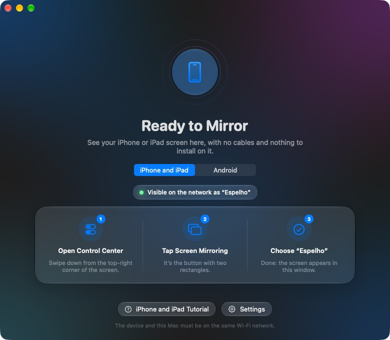
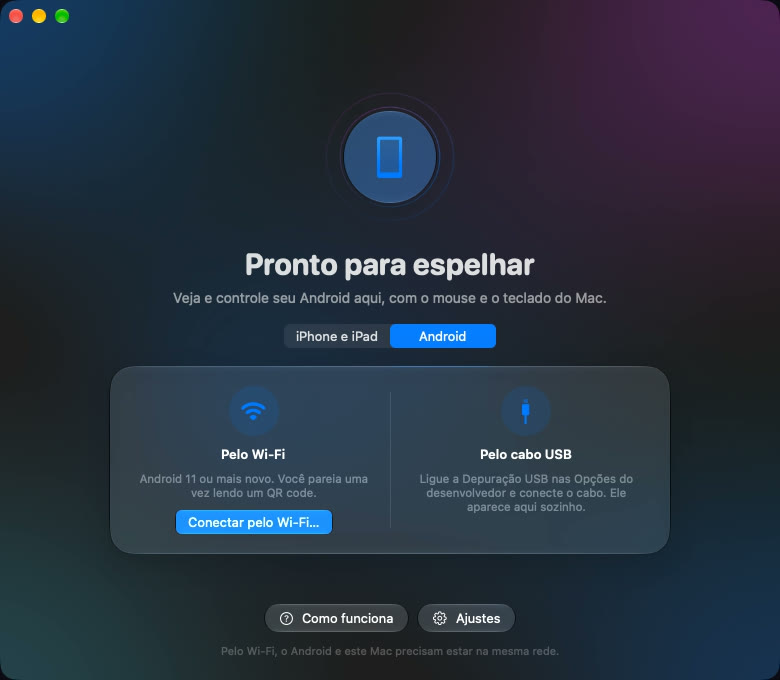
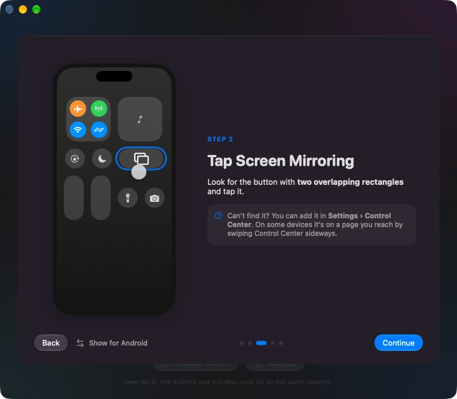

# Espelho

**English** · [Português](README.pt-BR.md)

Mirror an **iPhone, iPad or Android** phone or tablet into a window on your Mac, with sound. iPhone and iPad use **Screen Mirroring** from Control Center, with nothing to install on them. Android connects over Wi‑Fi (QR code) or a USB cable, and you can **use it with the Mac's mouse and keyboard**.

In English, Portuguese and Spanish: it follows the Mac’s language, and *Settings › Language* switches it. Free software (GPL-3.0), part of [witchmymac](https://witchmymac.com).



| Android | Step-by-step tutorial |
|---|---|
|  |  |

- **Real Screen Mirroring:** the Mac shows up in the iPhone/iPad list, with smooth video (frames paced by their own timestamps) and synced sound.
- **Android over Wi‑Fi:** pair once by scanning a QR code; after that Espelho connects by itself. A USB cable works too, and one click switches it to wireless.
- **Control Android from the Mac:** click, drag, scroll, type (accents included), paste with ⌘V, right click to go back, and Back/Home/Recents buttons.
- **Switch devices in one click:** the last device that connects is shown; the ⇄ button and the menu bar icon move between iPhone and Android.
- **Animated tutorial** for each platform, including the right menu path for Samsung, Xiaomi and Motorola/Pixel.
- **Mac-like:** Liquid Glass, menu bar icon, screenshots (⌘S), keep on top, fit the window to the device, open at login, in-app updates.

## Install

Requires **macOS 26 Tahoe or newer on Apple Silicon**.

1. **Terminal, one line (recommended):**
   ```sh
   curl -fsSL https://witchmymac.com/install.sh | bash -s espelho
   ```
   It downloads the latest release from GitHub, checks its SHA-256, installs Espelho in Applications and opens it, with no macOS warning (files downloaded by `curl` don't get the quarantine mark). Run it again to update. The script is open: [install.sh](https://witchmymac.com/install.sh).
2. **Download the DMG** from [Releases](https://github.com/matthfaria96/espelho/releases) or [witchmymac.com/espelho](https://witchmymac.com/espelho/), drag Espelho to Applications, then allow it once:
   ```sh
   xattr -dr com.apple.quarantine "/Applications/Espelho.app"
   ```
   (or open it, click OK, and use *System Settings › Privacy & Security › Open Anyway*).

After that, Espelho updates itself (it checks once a day and asks first).

Everything Espelho needs travels inside the app: no Homebrew, no drivers, nothing installed on the phone.

## Use

**iPhone / iPad:** open Espelho, allow *Local Network* the first time, then on the device: *Control Center › Screen Mirroring › Espelho*. Both must be on the same Wi‑Fi.

**Android (Android 11+), once per device:**
1. *Settings › About phone* › tap **Build number** 7 times (unlocks Developer options).
2. *Developer options* › turn on **Wireless debugging**.
3. In Espelho: **Android** tab › **Connect over Wi‑Fi…**, and on the phone: *Wireless debugging › Pair device with QR code*.

Android 10 or older: turn on *USB debugging*, plug the cable and click **Go Wireless**. Xiaomi/Redmi/POCO also need *USB debugging (Security settings)* to accept touches; Espelho tells you when that's missing.

Scanned the QR code and nothing happened? Check that the Mac and the phone are on the same Wi‑Fi (not a guest network) and that Espelho is on in *System Settings › Privacy & Security › Local Network*. Espelho finds the phone through macOS's own Bonjour and says so when that permission is off.

| On the Mac | Does |
|---|---|
| Double click · ⌃⌘F | Full screen |
| ⌘S · ⇧⌘C | Save a screenshot to *Pictures › Espelho* · copy the screen |
| ⌥⌘T · ⌘0 | Keep on top · fit the window to the device |
| ⌘D | Disconnect |
| Click, drag, scroll, type, ⌘V (Android) | Tap, swipe, scroll, type, paste |
| Right click · middle click (Android) | Back · Home |

Logs: `~/Library/Logs/Espelho.log` (AirPlay) and `~/Library/Logs/Espelho-Android.log` (also what pairing saw on the network). `ESPELHO_DEBUG=1 /Applications/Espelho.app/Contents/MacOS/Espelho` prints frame rate and pacing every second.

## How it works

- **iPhone/iPad:** [UxPlay](https://github.com/FDH2/UxPlay) runs hidden as the AirPlay receiver. A small patch (`scripts/patch-uxplay.py`) makes it report connection events and quit with the app. It forwards the H.264 stream over a local socket; Espelho decodes it with VideoToolbox and paces every frame by its timestamp (`Espelho/Sources/Espelho/Engine/`). Sound is decoded by GStreamer inside UxPlay.
- **Android:** the [scrcpy](https://github.com/Genymobile/scrcpy) server is pushed to the device with `adb`; Espelho receives H.264 video and raw PCM sound on local sockets and sends touches and keys back on the control socket (`Espelho/Sources/Espelho/Android/`, `Engine/Scrcpy.swift`).

## Build

Needs Xcode 26+ and Homebrew.

```sh
./scripts/make-espelho-app.sh   # builds and installs /Applications/Espelho.app for this Mac (uses Homebrew's libraries)
./scripts/make-release.sh       # the downloadable build: UxPlay, the GStreamer plugins it uses and all their
                                # libraries, adb and the scrcpy server bundled inside; signed and packed in a DMG
swift test --package-path Espelho
```

Translations: the Swift code is written with Portuguese strings, which are the keys; English and Spanish live in `scripts/translations.py`. `python3 scripts/make-localizations.py --check` writes the `.lproj` folders and lists any text still missing a translation (both build scripts run it). English is the fallback for every other language.

`make-release.sh` expects the witchmymac release tools (signing certificate, Sparkle key, DMG script) next to this repo; see the script header.

## License

Espelho is free software under the [GNU GPL v3.0](LICENSE). The download bundles third-party components under their own licenses (UxPlay GPL-3.0, GStreamer LGPL, FFmpeg GPL build, scrcpy and adb Apache-2.0, Sparkle MIT): see [THIRD-PARTY.md](THIRD-PARTY.md).
