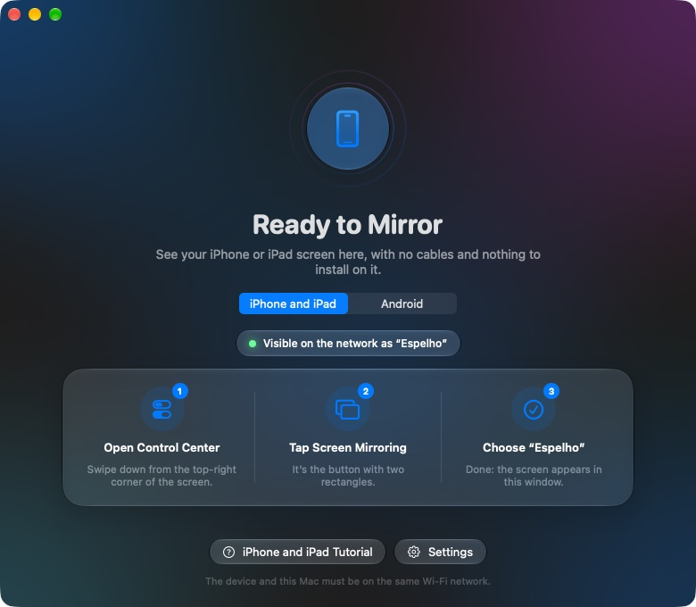
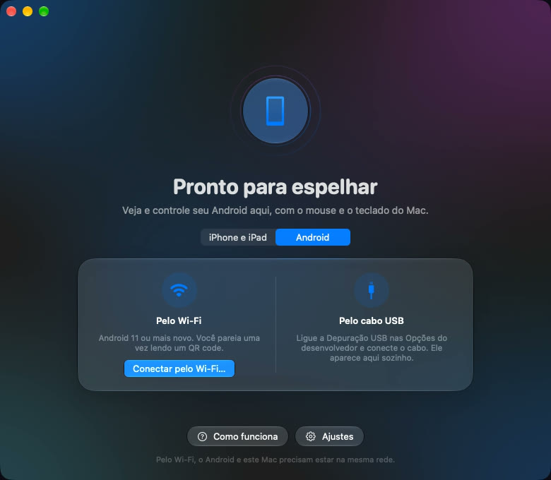
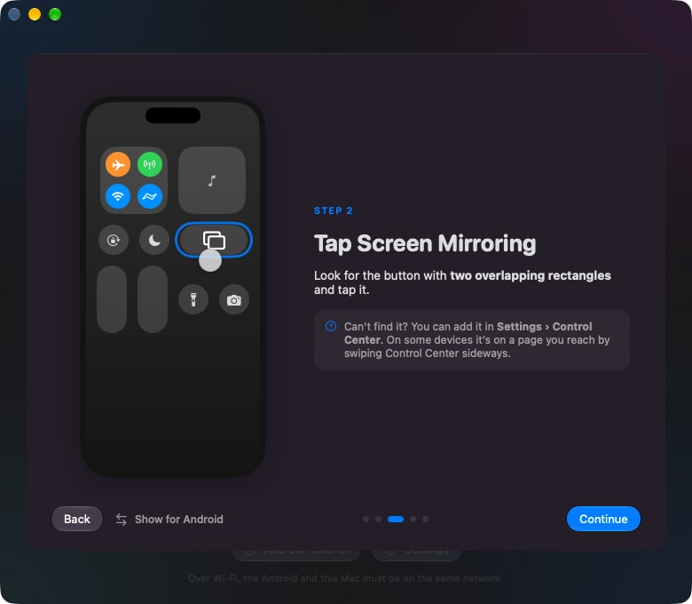

# Espelho

[English](README.md) · **Português**

Mostre a tela de um **iPhone, iPad ou Android** (celular ou tablet) numa janela do Mac, com som. O iPhone e o iPad usam o **Espelhar Tela** da Central de Controle, sem instalar nada neles. O Android conecta pelo Wi‑Fi (QR code) ou pelo cabo USB, e você **usa o aparelho com o mouse e o teclado do Mac**.

Em inglês, português e espanhol: segue o idioma do Mac, e *Ajustes › Idioma* troca. Software livre (GPL-3.0), parte do [witchmymac](https://witchmymac.com).



| Android | Tutorial passo a passo |
|---|---|
|  |  |

- **Espelhar Tela de verdade:** o Mac aparece na lista do iPhone e do iPad, com imagem fluida (cada quadro no ritmo do próprio aparelho) e som sincronizado.
- **Android pelo Wi‑Fi:** pareie uma vez lendo um QR code; depois o Espelho conecta sozinho. O cabo USB também funciona, e um clique passa a conexão para o sem fio.
- **Controle o Android pelo Mac:** clique, arraste, role, digite (com acentos), cole com ⌘V, botão direito para voltar, e botões Voltar/Início/Recentes.
- **Troque de aparelho num clique:** aparece o último aparelho que conectar; o botão ⇄ e o ícone da barra de menus passam do iPhone para o Android e de volta.
- **Tutorial animado** para cada plataforma, com o caminho certo dos menus em Samsung, Xiaomi e Motorola/Pixel.
- **Com cara de Mac:** Liquid Glass, ícone na barra de menus, capturas de tela (⌘S), manter no topo, janela no formato do aparelho, abrir ao iniciar o Mac e atualizações pelo próprio app.

## Instalar

Requer **macOS 26 Tahoe ou mais novo, em Mac com Apple Silicon**.

1. **Terminal, uma linha (recomendado):**
   ```sh
   curl -fsSL https://witchmymac.com/install.sh | bash -s espelho
   ```
   Baixa a versão mais recente do GitHub, confere o SHA-256, instala o Espelho em Aplicativos e abre, sem aviso do macOS (arquivos baixados pelo `curl` não recebem a marca de quarentena). Rode de novo para atualizar. O script é aberto: [install.sh](https://witchmymac.com/install.sh).
2. **Baixe o DMG** em [Releases](https://github.com/matthfaria96/espelho/releases) ou em [witchmymac.com/espelho](https://witchmymac.com/espelho/), arraste o Espelho para Aplicativos e libere uma vez:
   ```sh
   xattr -dr com.apple.quarantine "/Applications/Espelho.app"
   ```
   (ou abra, clique em OK e use *Ajustes do Sistema › Privacidade e Segurança › Abrir Mesmo Assim*).

Depois disso o Espelho se atualiza sozinho (procura uma vez por dia e pergunta antes).

Tudo o que o Espelho precisa vai dentro do app: sem Homebrew, sem drivers, nada instalado no celular.

## Usar

**iPhone / iPad:** abra o Espelho, permita *Rede Local* na primeira vez e, no aparelho: *Central de Controle › Espelhar Tela › Espelho*. Os dois precisam estar no mesmo Wi‑Fi.

**Android (Android 11 ou mais novo), uma vez por aparelho:**
1. *Configurações › Sobre o telefone* › toque **7 vezes** em **Número de compilação** (libera as Opções do desenvolvedor).
2. *Opções do desenvolvedor* › ligue a **Depuração por Wi‑Fi**.
3. No Espelho: aba **Android** › **Conectar pelo Wi‑Fi…**, e no celular: *Depuração por Wi‑Fi › Parear dispositivo com QR code*.

Android 10 ou mais antigo: ligue a *Depuração USB*, conecte o cabo e clique em **Usar sem fio**. Xiaomi/Redmi/POCO também precisam da *Depuração USB (configurações de segurança)* para aceitar toques; o Espelho avisa quando ela falta.

Leu o QR code e nada aconteceu? Confira se o Mac e o celular estão no mesmo Wi‑Fi (rede de convidados não serve) e se o Espelho está ligado em *Ajustes do Sistema › Privacidade e Segurança › Rede Local*. O Espelho encontra o celular pelo Bonjour do próprio macOS e avisa quando essa permissão está desligada.

| No Mac | Faz |
|---|---|
| Dois cliques · ⌃⌘F | Tela cheia |
| ⌘S · ⇧⌘C | Salva uma captura em *Imagens › Espelho* · copia a tela |
| ⌥⌘T · ⌘0 | Manter no topo · ajustar a janela ao aparelho |
| ⌘D | Desconectar |
| Clicar, arrastar, rolar, digitar, ⌘V (Android) | Tocar, deslizar, rolar, digitar, colar |
| Botão direito · botão do meio (Android) | Voltar · Início |

Registros: `~/Library/Logs/Espelho.log` (AirPlay) e `~/Library/Logs/Espelho-Android.log` (inclui o que o pareamento viu na rede). `ESPELHO_DEBUG=1 /Applications/Espelho.app/Contents/MacOS/Espelho` mostra a taxa de quadros e o ritmo a cada segundo.

## Como funciona

- **iPhone/iPad:** o [UxPlay](https://github.com/FDH2/UxPlay) roda escondido como receptor AirPlay. Um pequeno patch (`scripts/patch-uxplay.py`) faz ele avisar os eventos de conexão e fechar junto com o app. Ele repassa o vídeo H.264 por um socket local; o Espelho decodifica com o VideoToolbox e exibe cada quadro no tempo marcado (`Espelho/Sources/Espelho/Engine/`). O som é decodificado pelo GStreamer dentro do UxPlay.
- **Android:** o servidor do [scrcpy](https://github.com/Genymobile/scrcpy) é enviado ao aparelho pelo `adb`; o Espelho recebe vídeo H.264 e som PCM em sockets locais e manda toques e teclas de volta pelo socket de controle (`Espelho/Sources/Espelho/Android/`, `Engine/Scrcpy.swift`).

## Compilar

Precisa do Xcode 26+ e do Homebrew.

```sh
./scripts/make-espelho-app.sh   # compila e instala /Applications/Espelho.app para este Mac (usa as bibliotecas do Homebrew)
./scripts/make-release.sh       # a versão para download: UxPlay, os plugins do GStreamer que ele usa e todas as
                                # bibliotecas, adb e o servidor do scrcpy vão dentro; assinada e num DMG
swift test --package-path Espelho
```

Traduções: o código Swift é escrito com os textos em português, que servem de chave; inglês e espanhol ficam em `scripts/translations.py`. `python3 scripts/make-localizations.py --check` gera as pastas `.lproj` e lista os textos que ainda não têm tradução (os dois scripts de build rodam ele). O inglês vale para qualquer outro idioma.

O `make-release.sh` espera as ferramentas de release do witchmymac (certificado, chave do Sparkle, script do DMG) ao lado deste repositório; veja o cabeçalho do script.

## Licença

O Espelho é software livre sob a [GNU GPL v3.0](LICENSE). O download leva componentes de terceiros com licenças próprias (UxPlay GPL-3.0, GStreamer LGPL, FFmpeg em build GPL, scrcpy e adb Apache-2.0, Sparkle MIT): veja [THIRD-PARTY.md](THIRD-PARTY.md).
